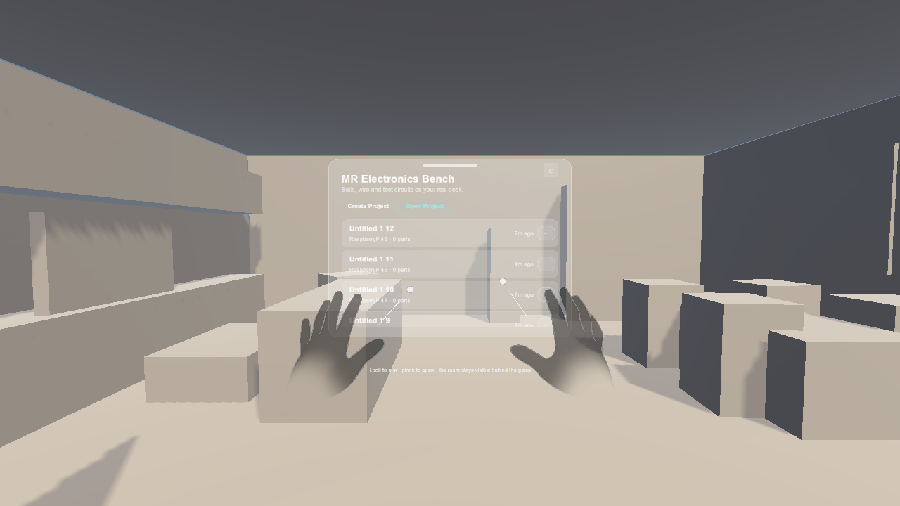
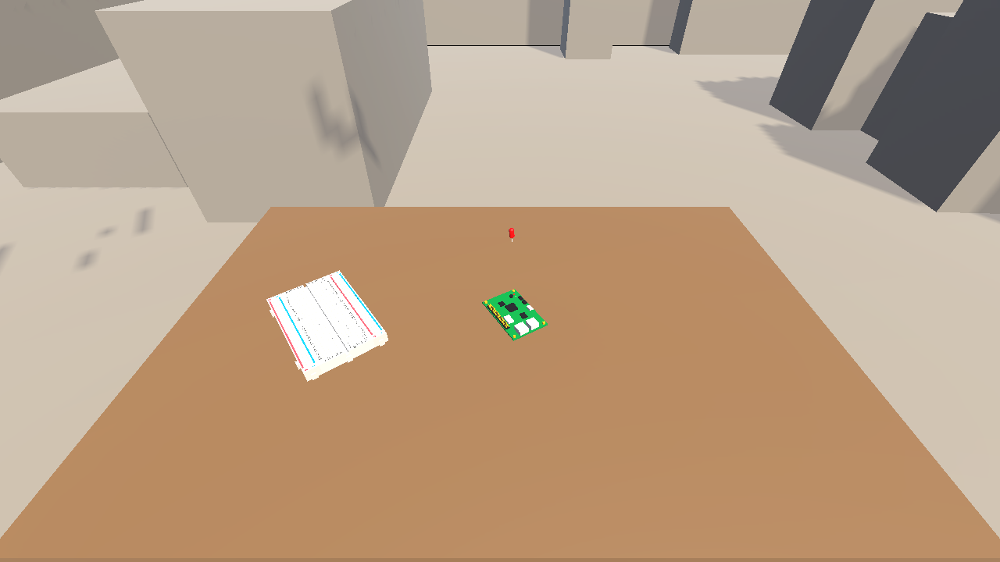
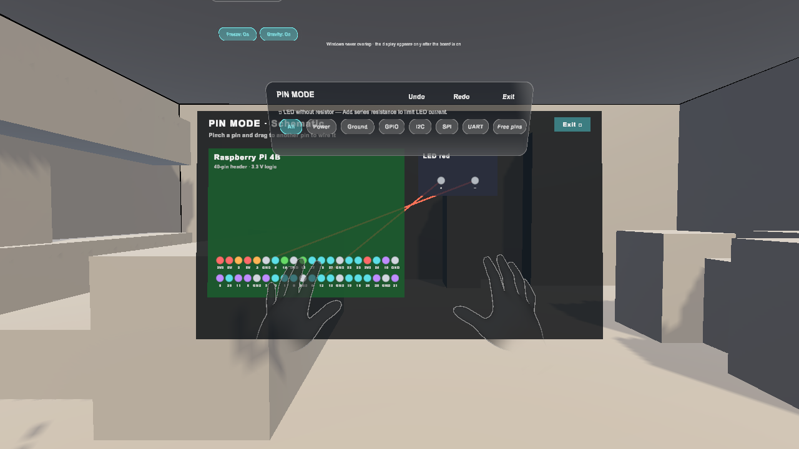
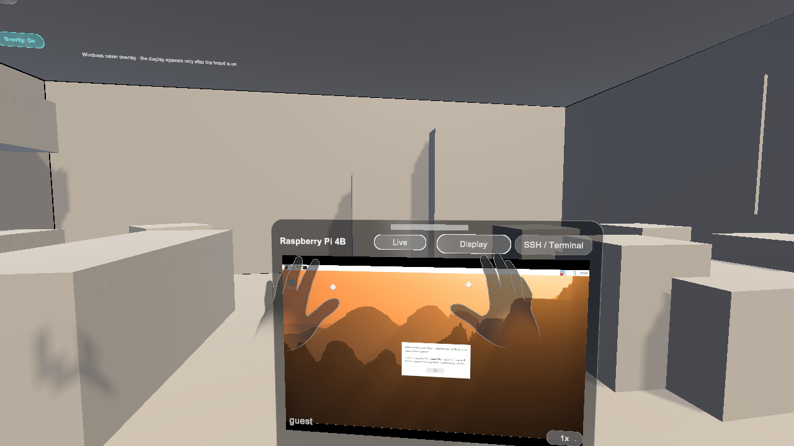
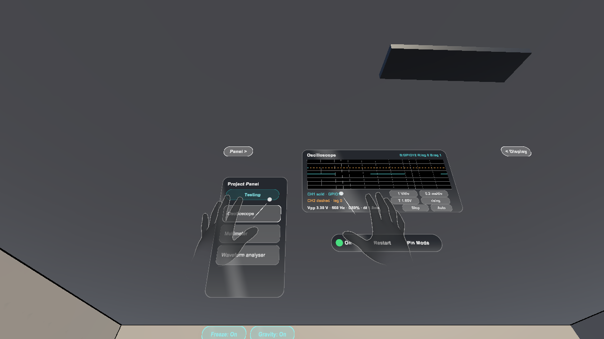
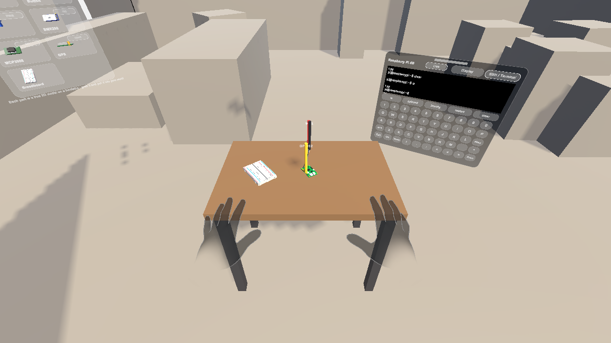

# Reaxim-VR — MR Electronics Bench

A mixed-reality electronics workbench for **Meta Quest** and **Meta VR Glasses**
(glasses-first hand control). Create a project, drag real-size boards and
components onto your desk, wire them in Pin Mode, power the board, and probe
the live circuit — with an optional live link to a Raspberry Pi digital twin.



## Features

- **Home** — liquid-glass window with Create Project (Blank / Raspberry Pi /
  Jetson Nano templates) and Open Project with recents, rename, duplicate,
  delete. Autosaves every 20 s, on state change, and on pause.
- **Project Panel** — Boards (Raspberry Pi 4B, Jetson Nano), Components
  (breadboard, LED, button, servo, BME280, MCP3008, GPS, …), and Testing tabs
  with 3D turntable cards.
- **Drag-out transition** — pull a card 6 cm and the panel glides left, the
  glass dissolves, and the part lands at real size with physics on MRUK room
  surfaces.
- **Board menu** — tap a board for On/Off (safe shutdown, never a hard cut),
  Restart, and Pin Mode.
- **Pin Mode** — a 2D MR schematic of every board/component with visible pins.
  Pinch/drag pin-to-pin to wire, filter chips (Power, Ground, GPIO, I2C, SPI,
  UART, Free), live validation (shorts, 5 V into 3.3 V GPIO, LED without
  resistor), undo/redo. Exit returns to the 3D scene.
- **Instruments** — oscilloscope (2 ch, trigger, cursors, Vpp/freq/duty),
  multimeter (V DC/AC, A, W, Ohm, continuity, diode), waveform analyser.
  Grabbable scope/red/black probe pens snap to pins, wires, and breadboard
  holes.
- **Display / SSH window** — appears on the right when a board powers on.
  Display tab shows the twin's Raspberry Pi OS desktop (hand cursor, pinch
  click/drag, scroll, zoom); SSH tab is a serial terminal with on-panel
  keyboard, quick commands, history, and a GPIO mini-strip.
- **Live twin link** — `IDataSource` with `SimulatedSource` and
  `LiveTwinSource` over WebSocket. GPIO, terminal, display frames, and probes
  stream both ways. No bridge in reach? Demo Mode (simulated Pi) takes over
  automatically — the app is fully usable with zero hardware.
- **Hands-first input** — gaze aims, pinch selects, poke presses, grab moves.
  Controllers optional; no physical keyboard or haptics required. Every action
  answers with glow, motion, and sound (2D UI + spatial 3D voices).




## The twin (companion app)

The Raspberry Pi twin lives in a separate app, **rpi-hvf** (macOS, Swift +
Hypervisor). This repo is the VR client; the twin is the server:

- Bridge URL: `ws://127.0.0.1:17890/` (loopback — XR Simulator and Unity
  Editor on the same Mac).
- Physical Quest on the same Wi-Fi: launch the twin with
  `--bridge-host 0.0.0.0` and point the app at `ws://<mac-lan-ip>:17890/`
  (the app remembers the last address that connected).
- The twin's VR panel has a one-click **Run on VR** button: it starts the
  bridge, then runs this app on a connected Quest (APK from
  `~/TwinVR/Builds`), or in the XR Simulator when no headset is attached.

The Pi OS itself is never inside the APK — the headset cannot run the VM.
Live mode = paired with a Mac running the twin; anywhere else = Demo Mode.




## Requirements

- **Unity 6000.6.7f1** with Android Build Support (IL2CPP).
- Packages (in `Packages/manifest.json`): Meta XR SDK **209.0.0**
  (core, interaction, platform, MRUK, audio, haptics), OpenXR **1.16.1**,
  XR Management 4.7.0, newtonsoft-json 3.2.2, glTFast (git).
- Render pipeline: Built-in RP (verified path).
- Device builds: JDK 17, Android SDK (platform 34, build-tools 34),
  **NDK r27c (27.2.12479018)**, CMake 3.22.1.
- Optional dev tools: `metavr` CLI (Meta VR CLI) and `unity` CLI.
- Target: Quest 3-class and Meta VR Glasses at 72 Hz; XR Simulator with the
  `Meta VR Glasses` device profile for desktop runs.

## Quick start

1. Open this folder in Unity Hub (6000.6.7f1) and let packages resolve.
2. Open `Assets/VR_scene.unity`.
3. (Simulator) Start the Meta XR Simulator, then press Play in the Editor.
4. On Home: create or open a project → drag the Pi card out → drag a
   breadboard and LED → Pin Mode → wire GPIO 12 → LED+ and LED− → GND →
   power on → open Testing, probe GPIO 12 with the scope pen.
5. (Live twin) Boot `rpi-hvf` with `--twin`, start its bridge, power the
   board: the Display tab shows the Pi desktop and SSH runs guest commands.



## Build (Android / Quest)

Identity: package `com.twinvr.mrbench`, version 1.0.0 (code 1). The package
is permanent once uploaded to a store listing — change it before first
upload if you need your own.

```sh
# from ~/TwinVR, Editor open, OUT of Play mode:
unity command script run --file Assets/Editor/BuildAndroid.cs \
  --entry BuildAndroid.Build --timeout 1500 --format json
```

Output: `Builds/MRBench.apk` (debug-signed: installs on a Quest for testing;
store upload needs a release keystore — set `MRBENCH_KEYSTORE`,
`MRBENCH_STOREPASS`, `MRBENCH_KEYALIAS`, `MRBENCH_KEYPASS` and rebuild).
Validated on the reference build: minSdk 32, targetSdk 34, ARM64-only,
`com.oculus.intent.category.VR` present, VR-only permissions.

Install/run on a connected headset:

```sh
metavr app install -r -g Builds/MRBench.apk
metavr app launch com.twinvr.mrbench --wait-for-idle
```

## Project structure

```
Assets/VR_scene.unity          main scene
Assets/Bench/                  the app
  Core/      AppStateMachine, settings, tweens
  Input/     gaze/hand abstraction (Bench.Hands)
  Glass/     liquid-glass overlay + passthrough styling
  Projects/  JSON store, templates, recents, autosave
  Windows/   WindowLayoutManager (slots, no-overlap solver)
  Library/   boards/components catalog data
  Workspace/ MRUK placement, physics, anchors, parts
  Circuit/   circuit model, solver, pin registry, validation
  PinMode/   2D schematic, wiring tool, filters
  Tools/     oscilloscope, multimeter, analyser, probe pens
  Panels/    Home, Project Panel, Board Menu, Display/SSH
  Data/      IDataSource (SimulatedSource, LiveTwinSource)
  Twin/      twin catalog (Pi 4B truth: pins, rails, parts)
  UI/        theme, glass windows, cards, sound bank
Assets/Twin/                   bridge client (TwinBridge, ITwinLink)
Assets/XR/                     OpenXR + XR Management settings
Assets/Editor/                 BuildAndroid, SetAndroidTools
```

Twin-side Unity client sources also live under the twin repo at
`Sources/RpiHvf/Bridge/UnityClient/` (kept in sync with `Assets/Twin/`).

## Controls

| Action   | Hands                 |
|----------|-----------------------|
| Aim      | Gaze (head fallback)  |
| Select   | Pinch (near + hand ray) |
| Press    | Poke near buttons     |
| Move     | Grab objects/windows  |
| Wire     | Poke-drag or pinch A then B |
| Scroll   | Swipe / pinch-drag    |
| Terminal | On-panel keyboard + quick commands |

## Status / limitations

- Editor + XR Simulator verified end to end (film-tour harness, 19 scenes).
- On-device 72 Hz still to be measured on hardware.
- Live twin needs the Mac reachable on the LAN; otherwise Demo Mode.
- Jetson Nano content is starter/UI-level; twin truth is Pi 4B only
  (3.3 V logic, 5 V supply rails).

## License

MIT — see [LICENSE](LICENSE).
